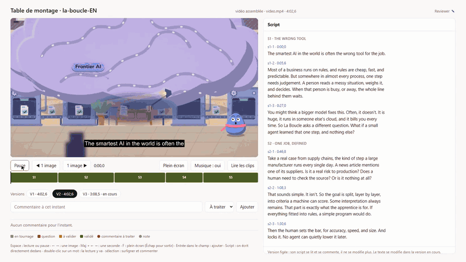

[English](README.md) · **Français**

# mod tournage

**Un mod de Claude Code qui fait d'un scénario une vidéo de démonstration commentée : un agent par séquence filme la vraie application ou anime un schéma, au rythme d'une voix de synthèse, et des relecteurs commentent sur une table de montage partagée.**

*La table de montage en ligne en usage : une vidéo animée faite avec le mod, puis des clips d'un jeu VR, un commentaire à l'instant précis et un commentaire sur le script. [Vidéo complète (1:49)](https://drive.google.com/file/d/1SZoBrUY1-yUUj2OjwhjZSsK4-osTDg5U/view)*

## Ce qu'on fait avec

- **Scénario.** `/tournage <démo>` ouvre le projet et Claude écrit le scénario, séquence par séquence. Un titre qui finit par « · filmée » se tourne sur l'application ; les autres sont animées.
- **La voix d'abord.** Chaque séquence est lue en une seule prise edge-tts. Les pauses viennent de la ponctuation et de ce dont l'image a besoin ; au-delà de 3,5 s, une alerte au lieu d'une pause.
- **Un agent par séquence.** Il filme l'application (web dans Chrome, ou casque VR) ou rend une animation SVG et GSAP image par image, au rythme de la voix.
- **Audit.** Chaque clip, puis la vidéo assemblée, est contrôlé (sauts, plans figés, images vides, silences) avant d'être montré.
- **Table de montage.** Les clips bout à bout, le script qui défile à côté. Un commentaire « à traiter » renvoie seulement sa séquence à son agent. Les versions V1, V2… gardent leur script et leurs commentaires.
- **Relecture en ligne.** Une adresse par démo. Les relecteurs donnent un nom, sans compte ; leurs commentaires reviennent dans la table locale.

## Architecture

## État

- **Depuis octobre 2026.** Construit en faisant une démo de 16 séquences d'un jeu de chaîne logistique, sur le web et en VR (7 min 16).
- **Vidéos.** Une présentation de La Boucle de 15 min 52 et sa version anglaise (15 min 54), et un pitch en anglais de 4 minutes.
- **Tables publiques.** [La Boucle, pitch en anglais](https://montage.ingevision.cloud/la-boucle-en/) · [SuMo 2.0, jeu VR](https://montage.ingevision.cloud/sumo2-0/)
- **Où ça tourne.** Le mod tourne dans Claude Code sur l'ordi de l'auteur : 951 images rendues par minute avec 12 navigateurs, plateau au-delà, sur un portable à 32 fils. La table en ligne est un serveur Python sans dépendance, dans un conteneur Docker derrière Traefik, sur un VPS.
- **Outils.** Python 3, Node.js, Playwright, edge-tts, ffmpeg, SVG et GSAP.

---

**Anthony Hunt** · [ingevision.cloud](https://ingevision.cloud/?p=mod-tournage) · [LinkedIn](https://www.linkedin.com/in/anthony-hunt-3948a9196) · [GitHub](https://github.com/anthohunt)

Le code est privé.
