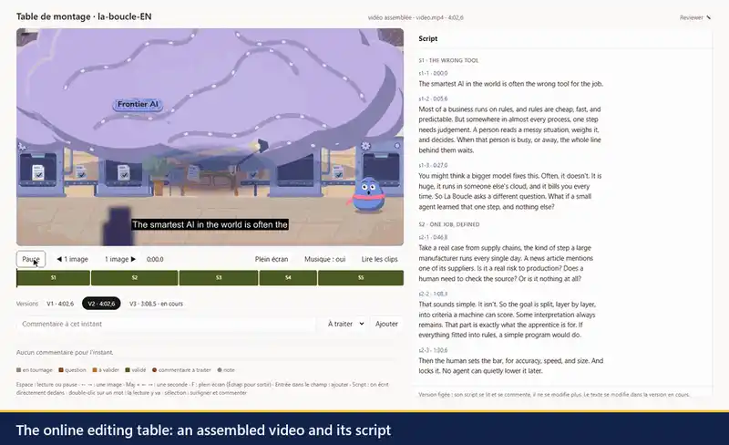
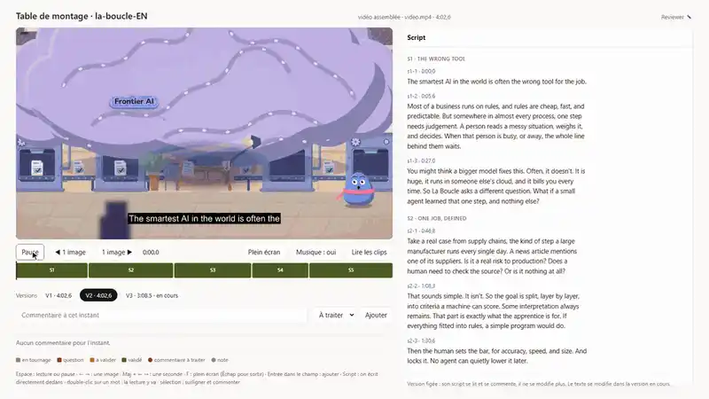

**English** · [Français](README.fr.md)

# mod tournage

**A Claude Code mod that turns a scenario into a narrated demo video, filmed on the real app or animated, and reviewed on a shared editing table.**

French version

*The online editing table in use; French interface, English captions. [Full video (1:49)](https://drive.google.com/file/d/1SZoBrUY1-yUUj2OjwhjZSsK4-osTDg5U/view)*

## Using it

- **Scenario.** `/tournage <demo>` opens the project and Claude writes the scenario, sequence by sequence. A title ending in "· filmée" (filmed) is shot on the app; the others are animated.
- **Voice first.** Each sequence is read in a single edge-tts take, which sets the pace of the pictures. Pauses come from punctuation and from what the picture needs; a pause longer than 3.5 s is not applied, you get an alert.
- **One agent per sequence.** It films the app (web in Chrome, or a VR headset) or renders an SVG and GSAP animation frame by frame.
- **Audit.** Each clip, then the assembled video, is checked for jumps, frozen shots, empty frames and silences before you see it.
- **Editing table.** Clips end to end, the script scrolling alongside. A comment marked "to do" sends only that sequence back to its agent. Versions V1, V2… keep their script and comments.
- **Online review.** One address per demo. Reviewers give a name, no account; their comments come back into the local table.

## Architecture

French version

## Status

- **Since October 2026.** Built while making a 16-sequence demo of SuMo, a supply-chain game on the web and in VR (7 min 16, private table).
- **Videos.** A presentation of [La Boucle](https://github.com/anthohunt/la-boucle-module), the author's method for handing one step of a process to a small model: [French, 15 min 52](https://drive.google.com/file/d/1TZXAxUeyCGkEj3yFR7hDBZXeerJQxmtA/view) · [English, 15 min 54](https://drive.google.com/file/d/1B0ZIb4txHxiYe0JcUWBq3rJRpRpqhCxr/view).
- **Public tables.** [La Boucle, 4-minute English version](https://montage.ingevision.cloud/la-boucle-en/) · [SuMo 2.0, VR redesign (4 clips)](https://montage.ingevision.cloud/sumo2-0/)
- **Where it runs.** Claude Code on the author's laptop (600-frame benchmark: 951 frames per minute with 12 browsers, flat beyond). The online table is a dependency-free Python server on a VPS.
- **Stack.** Python 3, Node.js, Playwright, Chrome, edge-tts, ffmpeg, SVG and GSAP.
- **Code.** Private.

---

**Anthony Hunt** · [ingevision.cloud](https://ingevision.cloud/?lang=en&p=mod-tournage) · [LinkedIn](https://www.linkedin.com/in/anthony-hunt-3948a9196) · [GitHub](https://github.com/anthohunt)
